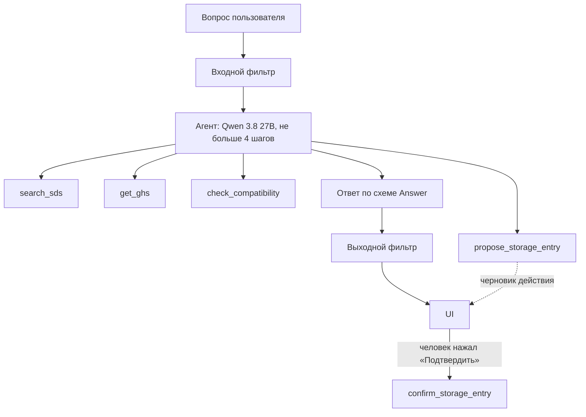

# Архитектура

LLM находит данные в SDS, вызывает инструменты и объясняет ответ. Решения, от которых зависит безопасность,
считает код: совместимость — по таблице TRGS 510, GHS — запросом к базе из PubChem.

## Компоненты

| Компонент | Модуль | Блок гайдлайнов |
|---|---|---|
| Схема ответа | `src/chemsafety/schemas.py` | 1 |
| Парсинг SDS | `src/chemsafety/parsing/` | 3 |
| Поиск | `src/chemsafety/retrieval/` | 4 |
| Инструменты | `src/chemsafety/tools/` | 5 |
| Агент | `src/chemsafety/agent.py` | 5 |
| Фильтры | `src/chemsafety/guardrails/` | 7 |
| Клиент модели и трейсинг | `src/chemsafety/llm.py`, `src/chemsafety/tracing.py` | 6 |
| Системы для сравнения | `src/chemsafety/systems/` | 2 |
| Оценка | `eval/` | 2 |

## Контракты инструментов

| Инструмент | Вход | Выход | Ошибки | Побочные эффекты |
|---|---|---|---|---|
| `search_sds` | `SearchSDSInput`: query, cas?, section?, top_k | `SearchSDSOutput`: hits | `not_found` | нет |
| `get_ghs` | `GetGHSInput`: cas | `GetGHSOutput`: H-коды, пиктограммы, сигнальное слово | `not_found`, `ambiguous` | нет |
| `check_compatibility` | `CheckCompatibilityInput`: два класса хранения | `CheckCompatibilityOutput`: verdict, источник правила | `invalid_input` | нет |
| `propose_storage_entry` | `StorageEntryProposal` | `PendingAction` | `invalid_input` | только черновик |
| `confirm_storage_entry` | action_id, approved_by | — | — | запись в журнал; вызывает только UI |

## Уровень автономии

Заполнить: почему ограниченный вызов инструментов, а не свободный агент. Опорные аргументы:
ошибка стоит здоровья, поэтому предсказуемость важнее гибкости; число шагов ограничено;
список инструментов фиксирован; единственное действие с последствиями подтверждает человек.

## Решения, которые нужно зафиксировать

- Какую из нескольких GHS-классификаций PubChem брать для вещества.
- Размер чанка и стратегия нарезки (по результатам абляции).
- Порог отказа по оценке поиска.
